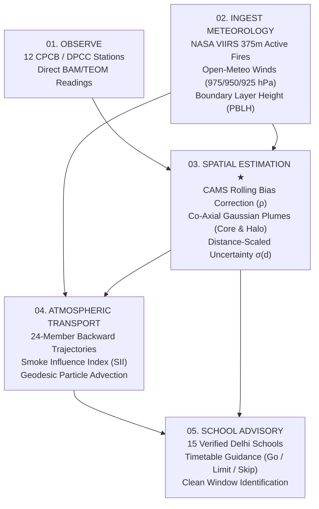

<!-- Improved compatibility of back to top link: See https://github.com/othneildrew/Best-README-Template/pull/73 -->
<a id="readme-top"></a>

<!-- PROJECT SHIELDS -->
[![Contributors][contributors-shield]][contributors-url]
[![Forks][forks-shield]][forks-url]
[![Stargazers][stars-shield]][stars-url]
[![Issues][issues-shield]][issues-url]
[![MIT License][license-shield]][license-url]
[![AWS Serverless][aws-shield]][aws-url]
[![Python 3.12][python-shield]][python-url]
[![TypeScript][typescript-shield]][typescript-url]

<!-- PROJECT LOGO -->
<br />
<div align="center">
  <a href="https://github.com/Atharva-Mendhulkar/pranvayu">
    
  </a>

  <h3 align="center">PranVayu (प्राणवायु)</h3>

  <p align="center">
    Physics-informed geospatial air quality intelligence, continuous PM2.5 spatial estimation, and school-day outdoor timetable advisories for Delhi NCR.
    <br />
    <a href="docs/01-PRD.md"><strong>Explore the documentation »</strong></a>
    <br />
    <br />
    <a href="#getting-started">Run the app</a>
    &middot;
    <a href="https://github.com/Atharva-Mendhulkar/pranvayu/issues/new?labels=bug">Report a bug</a>
    &middot;
    <a href="https://github.com/Atharva-Mendhulkar/pranvayu/issues/new?labels=enhancement">Request a feature</a>
  </p>
</div>

<!-- TABLE OF CONTENTS -->
<details>
  <summary>Table of Contents</summary>
  <ol>
    <li>
      <a href="#about-the-project">About The Project</a>
      <ul>
        <li><a href="#how-it-works">How It Works</a></li>
        <li><a href="#built-with">Built With</a></li>
      </ul>
    </li>
    <li>
      <a href="#getting-started">Getting Started</a>
      <ul>
        <li><a href="#prerequisites">Prerequisites</a></li>
        <li><a href="#installation">Installation</a></li>
      </ul>
    </li>
    <li>
      <a href="#usage">Usage</a>
      <ul>
        <li><a href="#intelligence-dashboard">Intelligence Dashboard</a></li>
        <li><a href="#physics-explainer">Physics Explainer</a></li>
        <li><a href="#commands">Commands</a></li>
      </ul>
    </li>
    <li><a href="#safety-and-trust-boundaries">Safety and Trust Boundaries</a></li>
    <li><a href="#architecture-and-aws-deployment">Architecture and AWS Deployment</a></li>
    <li><a href="#api">API</a></li>
    <li><a href="#roadmap">Roadmap</a></li>
    <li><a href="#contributing">Contributing</a></li>
    <li><a href="#license">License</a></li>
    <li><a href="#contact">Contact</a></li>
    <li><a href="#acknowledgments">Acknowledgments</a></li>
  </ol>
</details>

<!-- ABOUT THE PROJECT -->
## About The Project

PranVayu is an open-source, serverless air intelligence platform for Delhi parents, answering the 9 PM question: **can morning assembly, lunch recess, and PE happen outdoors tomorrow?**

Rather than displaying an abstract citywide average or leaving unmonitored neighborhoods in darkness, PranVayu addresses the fundamental question:

> *“What is the air quality where no monitoring station exists?”*

The National Capital Region spans 1,484 km², yet only a few dozen regulatory BAM/TEOM stations report ground observations. PranVayu couples observed ground stations with multi-level Open-Meteo atmospheric winds (975, 950, 925 hPa), boundary layer heights (PBLH), NASA VIIRS active fire detections, and Copernicus CAMS forecasts. Using a semi-analytical advection-dispersion formulation with co-axial Gaussian plumes and 24-member backward trajectories, it synthesizes a continuous physics-informed concentration field across Delhi NCR ($28.25^\circ-28.95^\circ\text{N}$, $76.75^\circ-77.60^\circ\text{E}$).

### Key Capabilities

* **School-Diary Timetable**: Ruled notebook diary with SVG verdicts (**Go**, **Limit**, **Skip**) across outdoor periods (Morning Arrival, Assembly, Recess & PE, Afternoon Dispersal) for 15 verified Delhi institutions.
* **Continuous Physics-Informed Field**: Continuous spatial estimation across the entire basin, distinguishing verified clean air (translucent emerald) from localized pollution cores (amber, rust, crimson).
* **Two-Component Hotspots (Core + Halo)**: Co-axial Gaussian formulation (1,350m core, 3,200m halo) preserving distinct high-intensity plumes (Anand Vihar, Wazirpur, Bawana) without merging into one giant blob.
* **Atmospheric Particle Advection**: Zoom-adaptive WebGL/Canvas particle transport tracking wind trajectories across real Delhi terrain.
* **Stubble Smoke Arrival Window**: Physics-grounded backward trajectory ensemble matching satellite fire detections. Smoke is reported honestly as arrival time ranges and qualitative influence tiers—never pseudoscientific mass percentages.
* **Zero-Network In-Place Recalculation**: Parents can adjust bell schedules directly in the browser using pre-distributed deterministic thresholds (`rules.json`).
* **Radical Transparency**: Pre-registered historical replay validation metrics (M1–M5) and explicit distance-scaled uncertainty bands ($\pm\sigma$).

Read the [Product Requirements](docs/01-PRD.md), [UX Specification](docs/02-UX-SPEC.md), [Algorithms Specification](docs/04-ALGORITHMS.md), and [Data Contracts](docs/05-DATA-CONTRACTS.md) for full design details.

<p align="right">(<a href="#readme-top">back to top</a>)</p>

### How It Works



PranVayu grounds its spatial estimation in the atmospheric advection-diffusion governing equation:

$$\frac{\partial C}{\partial t} + \mathbf{u} \cdot \nabla C = \nabla \cdot (\mathbf{K} \nabla C) + S$$

* $C$: PM2.5 spatial concentration field ($\mu\text{g/m}^3$)
* $\mathbf{u}$: Multi-level advection wind vector field (975, 950, 925 hPa)
* $\mathbf{K}$: Atmospheric turbulent eddy diffusivity tensor modulated by boundary layer ventilation (PBLH)
* $S$: Source terms from satellite active fire detections and Delhi industrial emission clusters

Rather than slow supercomputer PDE grids, PranVayu executes a semi-analytical physics-informed solution (co-axial Gaussian core/halo plumes + 2nd-order backward trajectories + rolling bias correction), enabling sub-second real-time evaluation.

<p align="right">(<a href="#readme-top">back to top</a>)</p>

### Built With

* [![Python][python-shield]][python-url]
* [![TypeScript][typescript-shield]][typescript-url]
* [![React][react-shield]][react-url]
* [![Three.js][three-shield]][three-url]
* [![Vite][vite-shield]][vite-url]
* [![AWS Lambda][aws-shield]][aws-url]
* [![DynamoDB][dynamodb-shield]][dynamodb-url]
* [![NumPy][numpy-shield]][numpy-url]
* [![Pydantic][pydantic-shield]][pydantic-url]
* [![Pytest][pytest-shield]][pytest-url]

<p align="right">(<a href="#readme-top">back to top</a>)</p>

<!-- GETTING STARTED -->
## Getting Started

PranVayu is fully testable and runnable locally with zero external network dependencies during offline runs.

### Prerequisites

* Python 3.11 or newer (Python 3.12 recommended)
* Node.js 18 or newer (Node 20+ recommended)
* npm 9 or newer
* `make` utility

### Installation

1. Clone the repository:

   ```sh
   git clone https://github.com/Atharva-Mendhulkar/pranvayu.git
   cd pranvayu
   ```

2. Set up Python virtual environment and backend dependencies:

   ```sh
   python3 -m venv .venv
   source .venv/bin/activate
   pip install -r backend/requirements.txt
   ```

3. Install frontend web dependencies:

   ```sh
   cd web
   npm install
   cd ..
   ```

4. Run the offline test suite:

   ```sh
   make test
   ```

5. Run code linting and frontend production build check:

   ```sh
   make lint
   ```

6. Generate local mock payloads across all 12 localities:

   ```sh
   make run-local
   ```

7. Start the local frontend development server:

   ```sh
   cd web && npm run dev
   ```

8. Open [http://localhost:5173](http://localhost:5173) in your browser.

<p align="right">(<a href="#readme-top">back to top</a>)</p>

<!-- USAGE EXAMPLES -->
## Usage

### Intelligence Dashboard

The main dashboard provides an obsidian/charcoal air intelligence workspace:

1. **Continuous Concentration Field**: A broad, soft atmospheric concentration field blankets Delhi NCR with visible contrast, where emerald indicates verified clean air ($\le 60\,\mu\text{g/m}^3$) and warm tones mark elevated concentrations.
2. **Distinct Hotspot Cores**: High-intensity cores (Anand Vihar, Wazirpur, Bawana, Jahangirpuri) emerge with localized intensity without drowning adjacent areas.
3. **Atmospheric Particle Advection**: Moving particles advect across terrain following wind vectors, concentrating naturally inside plumes.
4. **Schools Layer**: 15 authentic Delhi educational institutions with student counts, provenance anchors, and Go / Limit / Skip timetable guidance.
5. **Monitoring Stations**: Ground CPCB/DPCC monitoring stations display agency badges and verified BAM/TEOM sensor observations.
6. **Perplexity-Inspired Sidebar**: Hairline-divided sections for conditions, wind compass, school outlook, 48-hour air forecast curve, and priority advisories.

### Physics Explainer

Navigate to the technical explainer via the top navigation bar or direct URL:

```sh
http://localhost:5173/?page=method
```

The explainer provides a single-page, compact, animated 30-second technical breakdown of the physics-informed pipeline:
* **Interactive 5-Stage Tour**: Step through Observe, Ingest, Spatial Estimation, Transport, and School Advisory with play/pause automation.
* **4-Pillar Stage Cards**: Precise breakdown of What Enters, What The Engine Does, What Comes Out, and Most Important Limitation.
* **Novelty Comparison**: Side-by-side contrast between sparse raw station observations and continuous physics-informed spatial estimation (featuring unmonitored Najafgarh at 14.2 km with $52\,\mu\text{g/m}^3 \pm 37.6\,\mu\text{g/m}^3$).
* **Physics Panel**: Collapsible governing equation with plain-language mathematical explanations.

### Demo Scenarios & Query Controls

Toggle atmospheric scenarios via URL parameters:

* `http://localhost:5173/?state=stale`: Simulates stale monitoring station feed with fallback warning banner.
* `http://localhost:5173/?state=partial`: Simulates missing wind vectors with calm wind fallback.
* `http://localhost:5173/?state=down`: Simulates upstream API disruption with offline cached state.
* `http://localhost:5173/?state=replay`: Simulates pre-registered historical stubble smoke event replay.

### Commands

| Command | Purpose |
|---|---|
| `make test` | Run backend pytest suite (23 offline unit tests using fixtures) |
| `make lint` | Run ruff linter and frontend TypeScript build |
| `make run-local` | Run local pipeline on offline fixtures to generate mock payloads |
| `make evaluate` | Execute historical replay evaluation suite against M1–M5 metrics |
| `make web-build` | Compile optimized production web client (`< 30 kB` gzipped CSS) |
| `make deploy` | Deploy serverless infrastructure to AWS SAM (`ap-south-1`) |

<p align="right">(<a href="#readme-top">back to top</a>)</p>

<!-- SAFETY -->
## Safety and Trust Boundaries

PranVayu operates under strict scientific integrity and trust boundaries:

* **Honest Data Labeling**:
  * `MEASURED`: Direct physical observations from verified CPCB/DPCC BAM/TEOM sensors.
  * `ESTIMATED`: Continuous spatial concentration synthesized via atmospheric physics.
  * `UNCERTAIN / UNAVAILABLE`: Coordinates outside the modeling domain display `-- µg/m³ PM2.5` with an honest unavailable status—values are **never** fabricated.
* **No False Precision on Stubble Smoke**: Stubble smoke is reported as arrival time ranges and qualitative influence tiers (**Low**, **Moderate**, **High**, **Severe**). PranVayu never reports unprovable mass percentages (e.g., "X% of your air is stubble").
* **Distance-Scaled Uncertainty**: Spatial uncertainty expands with distance $d$ from the nearest monitoring station:
  $$\sigma(d) = 12.0 + 1.8 \min(d, 25)$$
* **Advisory Only**: Designed for parent school-day planning. It does not provide medical advice or replace statutory notifications from the Commission for Air Quality Management (CAQM) or CPCB.
* **Deterministic Rules Over Generative Text**: School verdicts, clean window calculations, and thresholds are strictly computed by deterministic code driven by `config/`. Language models never generate numbers or verdicts.

<p align="right">(<a href="#readme-top">back to top</a>)</p>

<!-- ARCHITECTURE -->
## Architecture and AWS Deployment

PranVayu utilizes a serverless precompute-and-cache architecture to guarantee sub-50ms response times for parents at 9 PM:

```
[EventBridge Schedulers]
       │
       ├── Hourly ───────► [Lambda: ingest_fires] ────► [S3: pv-raw/fires]
       ├── Hourly ───────► [Lambda: ingest_obs]   ────► [S3: pv-raw/obs]
       ├── 6-Hourly ─────► [Lambda: ingest_winds] ────► [S3: pv-raw/winds]
       └── 6-Hourly ─────► [Lambda: ingest_cams]  ────► [S3: pv-raw/cams]
                               │
       Hourly trigger ─────────┘
       │
       ▼
[Lambda: model_run]
       │  • Bilinear wind interpolation & 2nd-order trajectory ensemble
       │  • NASA VIIRS spatial-temporal deduplication & SII scoring
       │  • CAMS rolling bias ratio (ρ) correction & blend
       │  • Deterministic timetable rules & clean window search
       │  • Pydantic contract validation
       ▼
[DynamoDB: pv-state] (pk: locality_id, sk: run_time)
       ▲
       │
[API Gateway HTTP API] (/v1/forecast/{locality})
       ▲
       │
[Lambda: api] (Sub-50ms reads from DynamoDB)
       ▲
       │
[Amplify Hosting / CloudFront] ───► [PranVayu Web Client (React + TS)]
```

Deploy to AWS using AWS SAM CLI:

```sh
sam build -t infra/template.yaml
sam deploy --guided --stack-name pranvayu-prod --region ap-south-1
```

<p align="right">(<a href="#readme-top">back to top</a>)</p>

<!-- API -->
## API

<details>
  <summary>HTTP Endpoints</summary>

* `GET /v1/forecast/{locality}`: Returns 48-hour hourly air quality forecast, school timetable verdicts, clean window, and smoke arrival window for a locality.
* Supported localities: `anand_vihar`, `dwarka`, `punjabi_bagh`, `wazirpur`, `rohini`, `bawana`, `r_k_puram`, `ito`, `mandir_marg`, `jahangirpuri`, `patparganj`, `siri_fort`.

</details>

Sample API response contract:

```json
{
  "locality_id": "dwarka",
  "run_time": "2026-10-11T20:00:00+05:30",
  "current_pm25": 165.4,
  "aqi_equivalent": 334,
  "cpcb_category": "VERY_POOR",
  "confidence": "HIGH",
  "clean_window": {
    "start": "13:00",
    "end": "16:00",
    "predicted_pm25": 112.0
  },
  "smoke_influence": {
    "level": "MODERATE",
    "arrival_window": "16:00-21:00 IST",
    "trajectory_count": 24
  },
  "timetable_verdicts": [
    { "period": "Morning Arrival (07:30)", "verdict": "LIMIT", "pm25": 165.4 },
    { "period": "Assembly (08:30)", "verdict": "SKIP", "pm25": 182.1 },
    { "period": "Recess & PE (11:30)", "verdict": "LIMIT", "pm25": 142.0 },
    { "period": "Dispersal (14:30)", "verdict": "GO", "pm25": 112.0 }
  ]
}
```

<p align="right">(<a href="#readme-top">back to top</a>)</p>

<!-- ROADMAP -->
## Roadmap

- [x] Precompute-and-cache serverless architecture on AWS (`ap-south-1`)
- [x] Ruled school-diary timetable with SVG verdict shapes (Go / Limit / Skip)
- [x] Zero-network client-side "Change times" recalculation
- [x] Hand-crafted 48-hour air line chart with $p_{10}-p_{90}$ uncertainty band
- [x] Continuous physics-informed spatial estimation field across Delhi NCR
- [x] Co-axial two-component hotspot cores (core + halo) with FBM turbulence
- [x] Atmospheric particle advection and zoom-adaptive transport arrows
- [x] First-class schools layer with 15 verified Delhi institutions
- [x] Single-page animated 30-second technical explainer (`/method`)
- [x] Bilingual English and Hindi interface with hand-written strings
- [ ] Push notification alerts for school principals and parents
- [ ] Multi-city expansion across Indo-Gangetic Plain (Lucknow, Kanpur, Patna)
- [ ] On-device low-power sensor integration for school campus air quality

<p align="right">(<a href="#readme-top">back to top</a>)</p>

<!-- CONTRIBUTING -->
## Contributing

Contributions to make citizen air intelligence more transparent, accessible, and scientifically grounded are welcome.

1. Fork the project.
2. Create your feature branch: `git checkout -b feature/AmazingFeature`.
3. Ensure all tests and lint checks pass:
   ```sh
   make test && make lint
   ```
4. Commit your changes:
   ```sh
   git commit -m "feat(advisory): add localized morning assembly guidance"
   ```
5. Push to the branch: `git push origin feature/AmazingFeature`.
6. Open a Pull Request.

Please read [`AGENTS.md`](AGENTS.md) and [`CLAUDE.md`](CLAUDE.md) for repository conventions and hard rules before contributing.

<p align="center">
  <a href="https://github.com/Atharva-Mendhulkar/pranvayu/graphs/contributors">
    
  </a>
</p>

<p align="right">(<a href="#readme-top">back to top</a>)</p>

<!-- LICENSE -->
## License

Distributed under the MIT License. See [`LICENSE`](LICENSE) for details.

<p align="right">(<a href="#readme-top">back to top</a>)</p>

<!-- CONTACT -->
## Contact

Project Link: [https://github.com/Atharva-Mendhulkar/pranvayu](https://github.com/Atharva-Mendhulkar/pranvayu)

Issues and Feature Requests: [https://github.com/Atharva-Mendhulkar/pranvayu/issues](https://github.com/Atharva-Mendhulkar/pranvayu/issues)

<p align="right">(<a href="#readme-top">back to top</a>)</p>

<!-- ACKNOWLEDGMENTS -->
## Acknowledgments

* [Open-Meteo](https://open-meteo.com/) for multi-level winds and boundary layer forecasts
* [NASA FIRMS](https://firms.modaps.eosdis.nasa.gov/) for VIIRS 375m active fire data
* [Central Pollution Control Board (CPCB)](https://cpcb.nic.in/) and [OpenAQ](https://openaq.org/) for continuous ambient air monitoring
* [Copernicus Atmosphere Monitoring Service (CAMS)](https://atmosphere.copernicus.eu/) for regional atmospheric composition data
* [OpenFreeMap](https://openfreemap.org/) and [OpenStreetMap](https://www.openstreetmap.org/) for vector basemap geometry
* Environmental Hacks (Bharat Builds Tour, Event 02, Oct 2026) for the platform context

<p align="right">(<a href="#readme-top">back to top</a>)</p>

<!-- MARKDOWN LINKS & IMAGES -->
[contributors-shield]: https://img.shields.io/github/contributors/Atharva-Mendhulkar/pranvayu.svg?style=for-the-badge
[contributors-url]: https://github.com/Atharva-Mendhulkar/pranvayu/graphs/contributors
[forks-shield]: https://img.shields.io/github/forks/Atharva-Mendhulkar/pranvayu.svg?style=for-the-badge
[forks-url]: https://github.com/Atharva-Mendhulkar/pranvayu/network/members
[stars-shield]: https://img.shields.io/github/stars/Atharva-Mendhulkar/pranvayu.svg?style=for-the-badge
[stars-url]: https://github.com/Atharva-Mendhulkar/pranvayu/stargazers
[issues-shield]: https://img.shields.io/github/issues/Atharva-Mendhulkar/pranvayu.svg?style=for-the-badge
[issues-url]: https://github.com/Atharva-Mendhulkar/pranvayu/issues
[license-shield]: https://img.shields.io/github/license/Atharva-Mendhulkar/pranvayu.svg?style=for-the-badge
[license-url]: https://github.com/Atharva-Mendhulkar/pranvayu/blob/main/LICENSE
[aws-shield]: https://img.shields.io/badge/AWS-Serverless-FF9900?style=for-the-badge&logo=amazonaws&logoColor=white
[aws-url]: https://aws.amazon.com/
[python-shield]: https://img.shields.io/badge/Python-3.12-3776AB?style=for-the-badge&logo=python&logoColor=white
[python-url]: https://www.python.org/
[typescript-shield]: https://img.shields.io/badge/TypeScript-5-3178C6?style=for-the-badge&logo=typescript&logoColor=white
[typescript-url]: https://www.typescriptlang.org/
[react-shield]: https://img.shields.io/badge/React-18-61DAFB?style=for-the-badge&logo=react&logoColor=black
[react-url]: https://react.dev/
[three-shield]: https://img.shields.io/badge/Three.js-WebGL-000000?style=for-the-badge&logo=threedotjs&logoColor=white
[three-url]: https://threejs.org/
[vite-shield]: https://img.shields.io/badge/Vite-5-646CFF?style=for-the-badge&logo=vite&logoColor=white
[vite-url]: https://vitejs.dev/
[dynamodb-shield]: https://img.shields.io/badge/DynamoDB-Single--Digit_ms-4053D6?style=for-the-badge&logo=amazondynamodb&logoColor=white
[dynamodb-url]: https://aws.amazon.com/dynamodb/
[numpy-shield]: https://img.shields.io/badge/NumPy-Vectorized-013243?style=for-the-badge&logo=numpy&logoColor=white
[numpy-url]: https://numpy.org/
[pydantic-shield]: https://img.shields.io/badge/Pydantic-Contracts-E92063?style=for-the-badge&logo=pydantic&logoColor=white
[pydantic-url]: https://docs.pydantic.dev/
[pytest-shield]: https://img.shields.io/badge/Pytest-23_Tests_Offline-0A9EDC?style=for-the-badge&logo=pytest&logoColor=white
[pytest-url]: https://pytest.org/
